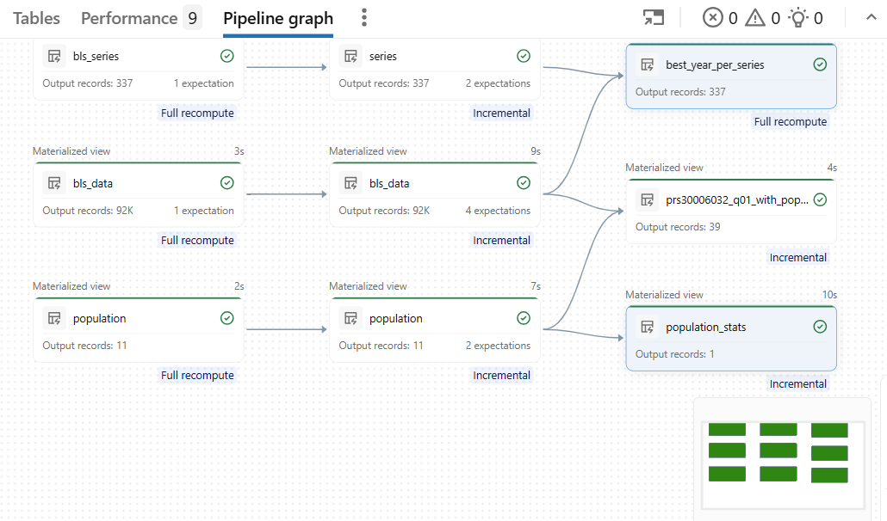
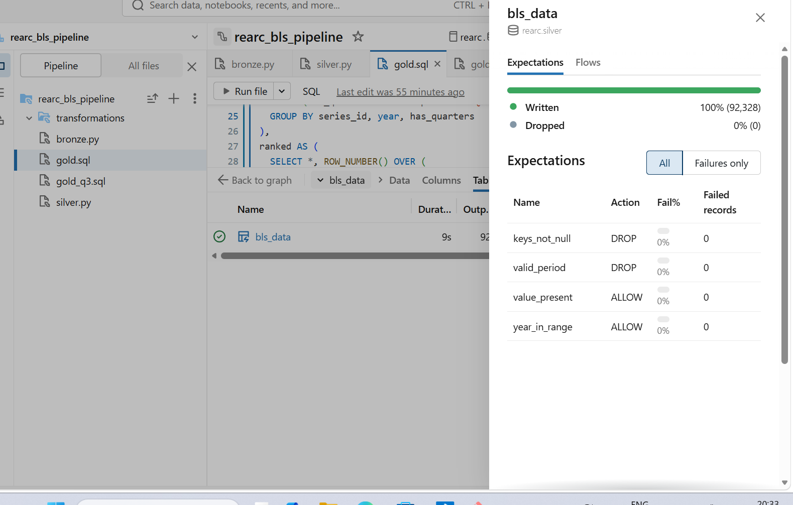
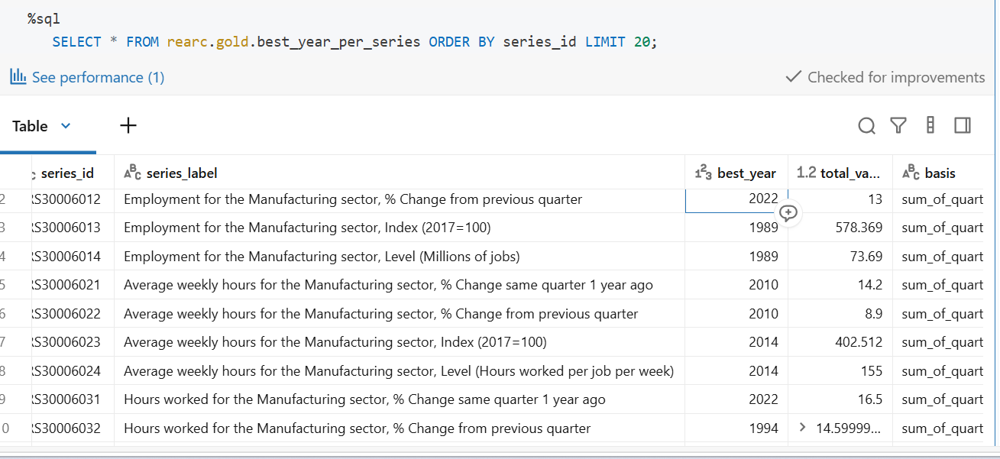
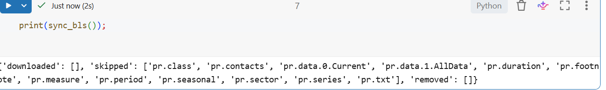
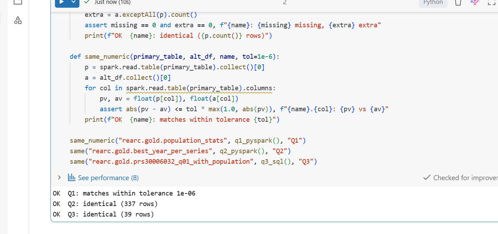

# PROCESS.md

Thought process for the Rearc Data Quest (Databricks edition). The README covers layout and how to run; this document covers why.

## AI disclosure

I used Claude as a reference and pairing tool throughout: to plan the approach, to draft the ingestion script, the pipeline files and the validation code, and to help read error messages. I ran everything in my own Databricks workspace and fixed the problems that came up myself, including:

- the population API endpoint returning 404 (the old DataUSA endpoint is retired),
- Python code pasted into a SQL file and SQL pasted into Python cells,
- an expectation referencing a column name that no longer existed after a rename,
- a Q2 count of 283 instead of 337 series, which I traced to 54 annual-only series,
- a validation failure on Q1 caused by exact floating-point comparison.

I checked each Gold result against the Silver data and can explain every line in this repo.

## Architecture

```
BLS website ──► ingest.py ──► Volume (raw files + manifest)
Population API ──►            │
                              ▼
                     Bronze (raw, trimmed strings)
                              ▼
                     Silver (typed, deduplicated, expectations)
                              ▼
                     Gold (3 answer tables)
```

### Ingestion (`ingestion/ingest.py`)

- **No hardcoded filenames.** It scrapes the directory listing at `download.bls.gov/pub/time.series/pr/` and syncs every file it finds (12 files today, including the data files, `pr.series`, the lookup files, `pr.txt` and `pr.contacts`), not just the data file.
- **Safe to re-run.** For each file it sends a `HEAD` request and compares `ETag`, `Last-Modified` and `Content-Length` with a manifest (`bls/_manifest.json`) stored in the Volume. Unchanged files are skipped. New or changed files are downloaded. Files removed at the source are deleted from the Volume and the manifest.
- **No half-written files.** A download goes to a temp file and is then moved into place.
- **Polite and compliant.** A `User-Agent` with contact details is sent on every request, as the BLS data access policy asks, with a one-second pause between downloads. (With a placeholder User-Agent I did not hit a 403, but BLS reserves the right to block anonymous bots, so I set real contact details.)
- **Population API.** Saved as `population/population.json`. It is overwritten on each run, which is idempotent because the response is small and the source is the same. The endpoint is the new DataUSA Tesseract API. The older `datausa.io/api/data` URL returned 404.
- **Evidence of idempotency.** First run: 12 files downloaded. Second run: `downloaded: []`, 12 skipped, 0 removed (`docs/idempotency_second_run.png`).

### Bronze

- Reads the raw files as they are, as strings, and adds lineage columns (`_source_file`, `_ingested_at`).
- **Trims column names and values.** BLS pads both: the headers are `'series_id        '` and `'       value'`, and `series_id` values carry trailing spaces. Without trimming, joins on `series_id` would silently match nothing.
- The population JSON is exploded from its `data` array into `nation_id`, `nation`, `year`, `population`.
- Expectation: `series_id IS NOT NULL` (drop).
- **Materialized views, not streaming tables.** BLS rewrites its files wholesale, so an append-only Auto Loader stream would create duplicates when a file changes. The data is small (about 92K rows), so a full recompute is cheap and always correct.
- Only `pr.data.1.AllData`, `pr.series` and the population JSON are modeled. The other lookup files are landed in the Volume but not used, because `pr.series` already has `series_title` (see below).

### Silver

- `year` cast to int, `value` cast with `try_cast(... AS DOUBLE)` so a non-numeric marker becomes NULL instead of failing the pipeline, `population` cast to long.
- Deduplicated on `(series_id, year, period)`; population on `year`.
- Expectations (they refer to the output column names, which I learned the hard way):

| Table | Expectation | Action |
|---|---|---|
| `silver.bls_data` | `keys_not_null` (series_id, year, period) | drop |
| `silver.bls_data` | `valid_period` (`Q01`-`Q05`) | drop |
| `silver.bls_data` | `year_in_range` (1900-2100) | warn |
| `silver.bls_data` | `value_present` | warn |
| `silver.series` | `series_id_not_null` | drop |
| `silver.series` | `label_present` | warn |
| `silver.population` | `year_not_null` | fail |
| `silver.population` | `population_positive` | drop |

- Result today: `silver.bls_data` wrote 92,328 rows, dropped 0, with 0 failed records on every expectation (`docs/data_quality_silver_bls_data.png`). That equals the raw row count (Q01 18,162; Q02 18,241; Q03 18,174; Q04 17,958; Q05 19,793). `silver.series` has 337 rows, equal to `pr.series`. The expectations are guards for future runs, not fixes for problems in today's data.

### Gold

| Question | Table | Primary | Alternative |
|---|---|---|---|
| Q1 | `rearc.gold.population_stats` | Spark SQL | PySpark |
| Q2 | `rearc.gold.best_year_per_series` | Spark SQL | PySpark |
| Q3 | `rearc.gold.prs30006032_q01_with_population` | Spark SQL | standalone SQL query |

**Honest note on the language split.** All three primaries are SQL. The assignment lets me pick per question, but it would show more range if one primary were PySpark. The Q3 alternative is a standalone `spark.sql` query rather than a PySpark DataFrame version. I started with a PySpark Q3 in the pipeline, but a Python snippet landed in a `.sql` file and I switched Q3 to SQL to keep moving. In production I would make Q3 the PySpark primary.

**Validation** (`validation/alternatives_and_validation.py`) compares each alternative with its Gold table. Q2 and Q3 are compared exactly with `exceptAll` in both directions. Q1 is compared with a 1e-6 relative tolerance. It passed exact comparison on the first run, then failed on a later refresh because the standard deviation differed only around the 13th-14th significant digit (4158441.040908095 vs 4158441.040908672). The mean was identical. Exact equality on floating-point aggregates is a flawed test, because aggregation order can differ between runs and engines (most likely between an incremental and a full refresh of the materialized view, though I did not confirm the exact cause). Output: `docs/validation_ok.png`.

## Data findings and decisions

1. **Read only `pr.data.1.AllData`.** `pr.data.0.Current` has 46,159 rows and every `(series_id, year, period)` key in it already exists in `AllData` (0 keys missing). Reading both would double-count. I compared keys only, not values.
2. **Periods are `Q01`-`Q05` only.** `Q05` is the annual figure, not a quarter. In the data, for series `PRS30006011` in 1988, Q01-Q04 are 1.9, 2.2, 1.9, 1.1 and Q05 is 1.8, which is not their sum. Summing all five periods would count the year twice, so Q2 sums `Q01`-`Q04` only.
3. **54 of the 337 series are annual-only** (they have `Q05` rows and no quarters; 1,914 rows in total). My first Q2 query returned only 283 series because those had nothing to sum. The task says "every series_id", so for annual-only series the "best year" is the year with the largest `Q05` value. A `basis` column (`sum_of_quarters` or `annual_only_Q05`) makes this visible, and an analyst can filter on `basis = 'sum_of_quarters'` for the strict definition. Result: 283 + 54 = 337 series, 0 null labels.
4. **Labels come from `series_title` in `pr.series`.** It is already human-readable, e.g. "Employment for the Manufacturing sector, Index (2017=100)", so I did not rebuild it from the sector, class, measure and duration lookup files.
5. **Tie-break for best year:** the most recent year (`ORDER BY total_value DESC, year DESC`).
6. **Incomplete current year.** 2026 has data only up to `Q03`, so its sum covers fewer quarters than full years. I followed the spec literally and flag the caveat. Also, many series are percent changes and can be negative, so a "sum of percent changes" is a literal reading of the spec rather than an economically meaningful measure.
7. **No non-numeric `value` entries** exist today. `try_cast` is a defence for the future.
8. **Q1 uses the sample standard deviation** (`STDDEV_SAMP`). The spec does not say which. The six annual values are a sample of a longer series, so the sample version is the usual default. The population version would be about 3.80 million.
9. **Population has no 2020.** The source has 11 rows (2013-2019 and 2021-2024). The ACS 1-year estimates were not released for 2020. Q3 therefore uses a `LEFT JOIN` ("where available"): BLS values are kept for every year, and population is NULL for 1988-2012, 2020 and 2025-2026. An inner join would have silently dropped those years.

## Results

| Question | Result |
|---|---|
| Q1 | mean 322,069,808; sample std dev 4,158,441.04 |
| Q2 | 337 series: 283 `sum_of_quarters`, 54 `annual_only_Q05` |
| Q3 | 39 rows (1988-2026); population joined for 2013-2019 and 2021-2024 |

## Screenshots







## Trade-offs: what I would do differently for a real client

- **Schema drift.** Today the pipeline reads `pr.data.1.AllData` by name, and Bronze selects columns by name. For production I would ingest with Auto Loader into streaming tables with `_rescued_data`, pin the expected schema with an expectation on the column list, and alert when BLS adds or renames columns. The ingestion discovers files dynamically, but the pipeline still names the data file, which is a gap I would close with a glob and a check on which `pr.data.*` files exist.
- **Change detection.** The manifest relies on `ETag`, `Last-Modified` and `Content-Length` from `HEAD`. If a server returned none of them, a changed file could be skipped. I would add a content hash as a fallback. The manifest is written at the end of a run, so a crash mid-run means some files are downloaded again next time, which is safe but wasteful.
- **Volume and cost.** At this size (about 92K rows) full recompute is the right trade-off. At hundreds of millions of rows I would move Bronze to incremental ingestion and partition or cluster Silver. Serverless compute is cheap for a small job but should be scheduled, not left on.
- **Access control.** Analysts should get `SELECT` on `rearc.gold` only (statements in the README, not executed here). The raw Volume and Bronze would be restricted to the pipeline's service principal.
- **Monitoring.** Alert on expectation drop and fail counts from the pipeline event log, on a row-count drop between runs, and on a BLS series count that shrinks.
- **Orchestration and deployment.** Schedule ingestion and the pipeline as a Databricks Job, with ingestion first. Deploy with Databricks Asset Bundles from Git instead of pasting files into the workspace.
- **Population source.** A third-party API with no SLA. I would snapshot every response with a timestamp and keep history instead of overwriting.
- **Testing.** The SQL vs PySpark comparison runs by hand in a notebook. I would run it as a pipeline-triggered job and fail the deployment on a mismatch.

## Retrospective

- **Hardest to get right: the data, not the code.** The first Q2 query ran cleanly and was wrong, because it silently lost 54 series. I only caught it because I compared the Gold count (283) with the Silver series count (337). Checking counts at each layer is what found it.
- **The population API had moved.** The endpoint in my first draft returned 404. I replaced it with the current Tesseract endpoint and then inspected the real field names (`Year`, `Population`) and years before modeling.
- **Whitespace in BLS files.** Padded headers and values broke the first column reference I tried. Printing `repr()` of the column names is what exposed it.
- **Pipeline mechanics.** I lost time to Databricks details: an auto-created "MV/ST" helper pipeline instead of a real ETL pipeline, a Python snippet pasted into a `.sql` file, expectations that must use the output column names, and `NameError` on `dp` when imports were dropped from a file. None of these affected the data logic, but they cost most of the debugging time.
- **Floating-point comparison.** My validation passed once and then failed on the same data. Switching Q1 to a tolerance was the correct fix, not a workaround.
- **Not done:** Genie space, dashboard, Asset Bundle deployment and executed access-control grants. The pipeline is also not yet wired to the Git folder as its source; I developed it in the workspace and copied the files into the repo.
